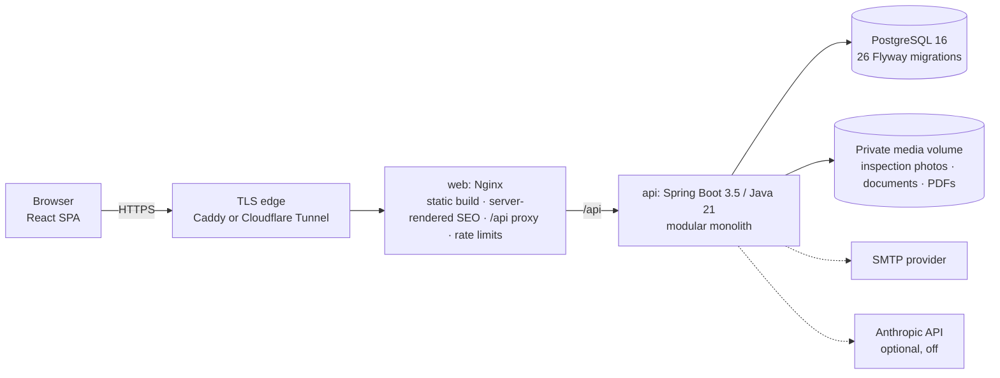

# SL Tours: booking and operations platform

A web platform for SL Tours, a tour operator in Cape Town, South Africa. It replaces a static brochure website, WhatsApp
messages and hand-made invoices with one system.

- **Public website:** visitors find tours, request bookings and private trips, and plan a day out.
- **Back office:** staff handle enquiries, bookings, quotations and invoices.
- **Driver portal:** drivers record the condition of each vehicle before and after a trip.

> **Status:** a working preview, not yet serving SL Tours' public domain. Launch waits on business decisions by SL Tours
> (live rates, booking terms, an email provider, a privacy review); see
> [Owner decisions](docs/operations/OWNER_DECISIONS.md) and [Release readiness](docs/operations/RELEASE_READINESS.md).
> This repository is a **curated snapshot**. Client-identifying details (a customer's name, the business street address
> and bank account number) have been replaced with placeholders. Commit IDs mentioned in the docs refer to the original
> development repository.

## Background

The work started with SL Tours' online presence, from December 2024:

- a static website;
- search metadata and Google Search Console verification;
- WhatsApp, Google review and TripAdvisor links.

Tours were booked through an external booking service, questions arrived by email and WhatsApp, prices were copied by
hand across pages, and staff had no shared record of enquiries, vehicles or drivers. In October 2026 this platform was
built to bring those workflows into one system while keeping the established SL Tours look.

## What it does

| Who | What they can do |
|---|---|
| **Visitors** | Browse 9 tours and send enquiries; request a tour booking; book an hourly private trip with a vehicle priced by the server; explore 127 researched attractions across the Western Cape, each with its source and check date; build a priced day plan; optionally chat with a planning assistant (switched off by default) |
| **Customers** | Create an account with email verification; see their own enquiries, bookings, quotations and invoices; upload proof of payment |
| **Staff and administrators** | Work an enquiries inbox; manage bookings and customers, tours and prices, private-trip rates, vehicles, drivers and their documents; assign trips; review vehicle inspections; issue quotations, invoices and receipts (PDF and Word); manage referral partners; export data |
| **Drivers** | See only their own trips on a phone; record collection and return inspections with a checklist, photos, odometer and a selfie |
| **Partners** | Hotels and agents track their referrals and commission; experience suppliers propose new activities |

## Architecture



| Layer | Technology |
|---|---|
| Frontend | React 18, TypeScript, Vite, React Router, TanStack Query, react-hook-form + zod |
| Backend | Java 21, Spring Boot 3.5 (web, security, data JPA, validation, mail), Flyway, openhtmltopdf |
| Database | PostgreSQL 16 |
| Delivery | Docker Compose, Nginx behind an HTTPS proxy, GitHub Actions CI with a Trivy security scan |

The API is one deployable application split into domain packages (`apps/api/src/main/java/com/sltours/<domain>/`).
The frontend is organised by feature (`apps/web/src/features/<area>/`). The reasoning behind the main choices is in the
[architecture decision records](docs/architecture/ADR/README.md).

## Engineering highlights

- **The server owns every price.** Tour, private-trip and invoice totals are calculated in integer cents on the server;
  totals sent by a browser are ignored. See `BookingService.calculateTotal`, `privatetrips/service/PriceCalculator.java`
  and `billing/service/BillingCalculator.java`.
- **The database prevents double-booking.** PostgreSQL exclusion constraints stop a vehicle or a driver being assigned
  to overlapping trips, even when two staff members confirm at the same moment
  (`apps/api/src/main/resources/db/migration/V9__fleet_assignments_inspections.sql`). A test confirms both requests
  concurrently and checks that only one succeeds.
- **Financial records are immutable.** Issuing an invoice freezes everything printed on it. Invoice numbers are taken
  under a database row lock, so they are never duplicated or reused (`billing/service/NumberAllocator.java`).
  Corrections are made by revision.
- **Retries never create duplicates.** Every public form sends an idempotency key, so a retry after a lost response
  returns the original record instead of creating a second one.
- **Unverified facts are labelled, not hidden.** Attraction prices record their source, check date and validity
  period. Expired, conflicting or unpublished prices show as "not verified", and a day plan is said to fit a budget only
  when every cost is verified (`activities/service/ItineraryService.java`).
- **The AI assistant is guarded.** It may only call approved planner tools. A reply containing a price, time or
  discount that did not come from those tools is replaced before the visitor sees it
  (`assistant/service/ReplyGuard.java`). Spending caps apply, and the assistant is off unless configured.
- **Security model:**
  - session cookies (HttpOnly, SameSite) and CSRF protection on every write;
  - default-deny URL rules and per-record ownership checks (another user's record behaves as missing);
  - uploads checked by content, not file name;
  - the production profile refuses unsafe settings at startup (`config/SecurityConfig.java`,
    `config/ProductionSafetyCheck.java`).

  The model is described in [docs/security](docs/security/SECURITY_MODEL.md). It has not been independently
  penetration-tested.
- **Search engines see real pages.** Nginx inserts per-page titles, descriptions, canonical links and structured data
  rendered by the API, and unknown pages return a real 404 ([SEO](docs/operations/SEO.md)).

## Run it locally

Requires Docker with Compose. Node 20 and Java 21 are only needed to run the checks outside Docker.

```bash
cp .env.example .env          # local development values; change passwords for any shared server
docker compose up --build
```

| URL | What |
|---|---|
| http://localhost:8080 | Website |
| http://localhost:8080/operations | Staff sign-in (`SLTOURS_ADMIN_USERNAME` / `SLTOURS_ADMIN_PASSWORD` from `.env`) |
| http://localhost:8025 | Mailpit: catches account emails locally, sends nothing |
| http://localhost:8081/swagger-ui | API documentation (local only) |

The defaults are for local development only: the `dev` profile shows clearly labelled sample prices and creates demo
driver accounts. For a shared server, follow [Deployment](docs/operations/DEPLOYMENT.md) and
[HTTPS and migration](docs/operations/HTTPS_AND_MIGRATION.md).

## Tests

```bash
npm ci
npm --workspace @sltours/web run typecheck
npm --workspace @sltours/web run test     # 111 tests
npm --workspace @sltours/web run build
mvn -f apps/api/pom.xml verify            # 177 tests; integration tests use a throwaway PostgreSQL (Testcontainers, needs Docker)
```

The suites cover:

- pricing and rounding;
- concurrent bookings, invoice numbering and payouts;
- role and ownership boundaries for every portal;
- CSRF and session timeout;
- inspection rules;
- catalogue honesty;
- the assistant's reply checks;
- PDF and Word rendering.

Browser journeys (`tools/journeys`) and a route smoke test (`tools/smoke/routes.sh`) run against a local stack. See the
[testing guide](docs/testing/TESTING_GUIDE.md).

## Documentation

| Area | Start here |
|---|---|
| Product and requirements | [Operations requirements](docs/product/SL_TOURS_OPERATIONS_REQUIREMENTS.md) · [Explore catalogue](docs/product/EXPLORE_CATALOGUE.md) · [Partnerships](docs/product/PARTNERSHIPS.md) |
| Architecture and data | [Decision records](docs/architecture/ADR/README.md) · [Data model](docs/database/DATA_MODEL.md) · [API overview](docs/api/API_OVERVIEW.md) |
| Security | [Security model](docs/security/SECURITY_MODEL.md) · [Threat model](docs/security/THREAT_MODEL.md) · [POPIA notes](docs/security/POPIA_NOTES.md) |
| Operations | [Deployment](docs/operations/DEPLOYMENT.md) · [Backup and recovery](docs/operations/BACKUP_AND_RECOVERY.md) · [CI/CD](docs/operations/CI_CD_PIPELINE.md) · [Performance](docs/operations/PERFORMANCE.md) |
| Using the system | [Admin guide](docs/development/ADMIN_GUIDE.md) · [Driver guide](docs/development/DRIVER_GUIDE.md) · [Invoicing](docs/billing/INVOICING.md) |
| Learning notes | [Learning log](docs/learning/LOG.md) · [Glossary](docs/learning/GLOSSARY.md) |

## Known limitations

- No payment gateway: payments are recorded and confirmed by staff.
- No automatic email or WhatsApp notifications: staff share documents through prepared WhatsApp messages and links.
- Sessions, rate limits and assistant conversations are held in memory, which suits a single server.
- CI builds and tests every change; publishing images and automated deployment are planned
  ([CI/CD](docs/operations/CI_CD_PIPELINE.md)).

## Credits

Built by **Tshidiso Molefe** (Tlokwa Digital Solutions) for SL Tours, covering
requirements, design, implementation, testing and deployment. The platform was developed with AI coding assistants
(OpenAI Codex for the initial foundation; Anthropic Claude for review and later changes), directed, reviewed and tested
by the author.

Third-party material:

- attraction photos from Wikimedia Commons (credits and licences in
  [docs/things-to-do/media.md](docs/things-to-do/media.md));
- Liberation Sans and Barlow fonts (SIL Open Font License);
- Elfsight reviews widget, Google Translate widget and Frankfurter exchange rates in the browser.

No open-source licence is granted. The code is published for portfolio review.
