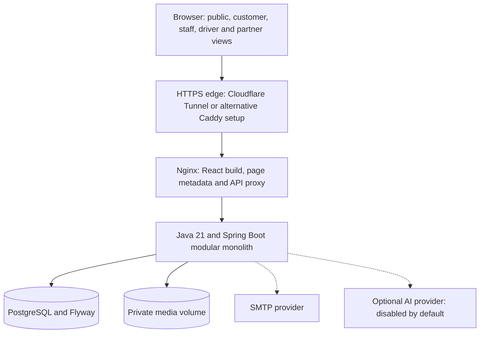

# SL Tours: booking and operations platform

A client-led booking and operations platform for SL Tours, a tour operator in Cape Town, South Africa.
Built within **Tlokwa Digital Solutions** to connect the public website with enquiries, quotations, invoices,
bookings, referrals and trip operations.

- **Public website:** visitors find tours, request bookings and private trips, and plan a day out.
- **Back office:** staff handle enquiries, bookings, quotations and invoices.
- **Driver portal:** drivers record the condition of each vehicle before and after a trip.

> **Status:** deployed for client review at **[sltours.tlokwadigital.com](https://sltours.tlokwadigital.com/)**,
> running on a DigitalOcean droplet and tunnelled through the Tlokwa Digital domain
> ([what running it there taught us](#deployment-and-lessons-learned)). It does not yet serve SL Tours' public domain,
> sl-tours.com. Launch waits on business decisions by SL Tours
> (live rates, booking terms, an email provider, a privacy review); see
> [Owner decisions](docs/operations/OWNER_DECISIONS.md) and [Release readiness](docs/operations/RELEASE_READINESS.md).
> This repository is a **curated snapshot**. Client-identifying details (a customer's name, the business street address
> and bank account number) have been replaced with placeholders. Commit IDs mentioned in the docs refer to the original
> development repository.

## How the project came about

My work with SL Tours started in **November 2024**, when the business had no online presence. I helped establish its
website, SEO and Google Business Profile so people could find its services and get in touch. The static website was
the first step. As the relationship grew, our conversations moved into the daily work of running the business.

Mr Liso approached me about the time spent creating invoices by hand. Trip details, services and prices had to be
prepared, checked and sent for each customer. Changes meant editing the document again. Marketing brought another
problem: keeping track of who referred a customer and what happened after that referral.

Those conversations shaped this system. I used SL Tours' existing invoice layout as a starting point so the documents
would remain familiar. The aim was to reduce repeated typing, keep customer requests easier to follow and connect
referral codes to actual bookings and recorded payments.

The relationship began in November 2024; the earliest static-site commit in the original development history is from
December 2024. The operations platform followed in October 2026. This curated repository contains the application
snapshot; it does not contain the complete history of that earlier work.

## Building around the client's work

| Client need | System response | Intended benefit |
|---|---|---|
| Preparing quotations and invoices by hand | Reusable document layout, service lines, previews, PDF and Word output | Less time rebuilding documents and copying details |
| Following a request across several conversations | Enquiries inbox, booking records and linked billing documents | A clearer record of the customer's request and its progress |
| Understanding referred business | Partner reference codes, referral records and commission ledgers | Trace a referral through to a booking and its payment status |
| Coordinating vehicles and drivers | Trip assignments, availability rules and collection/return inspections | Keep trip responsibilities and vehicle condition records together |
| Keeping public tour information consistent | Database-backed catalogue with staff administration | Manage tour details and prices from the same source |

These are the problems the software is designed to address. I have not yet measured time saved, increased bookings or
revenue from the platform. Payments, vehicle release and commercial agreements still require the responsible people
to make or confirm decisions.

### My role and the Tlokwa connection

I owned the work from client discussions and design through implementation, testing and deployment, using coding tools
and AI assistance along the way. The [credits](#credits) describe that assistance and third-party material.

SL Tours is a client project within Tlokwa Digital Solutions and the **first client to request this kind of tourism
operations system**. It gives us a practical starting point for learning what small tourism businesses need beyond a
website. Client review will help us understand what is useful, what needs simplifying and what could support another
business. It is not yet evidence of a validated product for the wider tourism market.

## What it does

| Who | What they can do |
|---|---|
| **Visitors** | Browse 9 tours and send enquiries; request a tour booking; book an hourly private trip with a vehicle priced by the server; explore 127 researched attractions across the Western Cape, each with its source and check date; build a priced day plan; optionally chat with a planning assistant (switched off by default) |
| **Customers** | Create an account with email verification; see their own enquiries, bookings, quotations and invoices; upload proof of payment |
| **Staff and administrators** | Work an enquiries inbox; manage bookings and customers, tours and prices, private-trip rates, vehicles, drivers and their documents; assign trips; review vehicle inspections; issue quotations, invoices and receipts (PDF and Word); manage referral partners; export data |
| **Drivers** | See only their own trips on a phone; record collection and return inspections with a checklist, photos, odometer and a selfie |
| **Partners** | Hotels and agents track their referrals and commission; experience suppliers propose new activities |

## Architecture



| Layer | Technology |
|---|---|
| Frontend | React 18, TypeScript, Vite, React Router, TanStack Query, react-hook-form + zod |
| Backend | Java 21, Spring Boot 3.5 (web, security, data JPA, validation, mail), Flyway, openhtmltopdf |
| Database | PostgreSQL 16 |
| Delivery | Docker Compose, Nginx behind an HTTPS proxy, GitHub Actions CI with a Trivy security scan |

The API is one deployable application split into domain packages (`apps/api/src/main/java/com/sltours/<domain>/`).
The frontend is organised by feature (`apps/web/src/features/<area>/`). The reasoning behind the main choices is in the
[architecture decision records](docs/architecture/ADR/README.md).

## Main technical decisions

| Decision | Why it fits this project | Trade-off |
|---|---|---|
| React, TypeScript and Vite | Reusable interfaces for public pages and several role-specific portals; typed forms and API interactions | Requires a build step and ongoing dependency maintenance |
| Java 21 and Spring Boot as a modular monolith | Keep booking, billing and operations rules in one deployable application with domain boundaries | Package boundaries need discipline; the application scales as one unit |
| PostgreSQL with Flyway | Relational records, transactions and database constraints suit bookings, assignments and financial documents; migrations make schema changes reviewable | Database changes need compatibility checks, backups and recovery planning |
| Server-side pricing and billing | The browser cannot determine authoritative prices; issued documents retain their agreed values | Pricing rules and revisions need explicit business policies |
| Database accounts and cookie sessions | Staff and customers can sign in without exposing reusable credentials in the frontend; CSRF protects session-based mutations | Sessions and sign-in limits are instance-local in the current design |
| Nginx beside the API | Same-origin API calls and server-inserted page metadata support both authenticated workflows and search visibility | We operate the server and deployment rather than relying only on static hosting |
| Private persistent media volume | Inspection photos and driver documents stay behind authorised API access without another storage service | Backups must include both database and media; multiple servers would need shared storage |

The [decision records](docs/architecture/ADR/README.md) give the context and consequences. HTTP Basic was a foundation
choice that has been superseded by session authentication. Building release images in CI and having the server pull
them remains a proposal, separate from the existing CI checks.

## Engineering highlights

- **The server owns every price.** Tour, private-trip and invoice totals are calculated in integer cents on the server;
  totals sent by a browser are ignored. See `BookingService.calculateTotal`, `privatetrips/service/PriceCalculator.java`
  and `billing/service/BillingCalculator.java`.
- **The database prevents double-booking.** PostgreSQL exclusion constraints stop a vehicle or a driver being assigned
  to overlapping trips, even when two staff members confirm at the same moment
  (`apps/api/src/main/resources/db/migration/V9__fleet_assignments_inspections.sql`). A test confirms both requests
  concurrently and checks that only one succeeds.
- **Issued documents retain a snapshot.** Issuing an invoice freezes its printable contents. Invoice numbers are allocated
  under a database row lock to prevent concurrent allocation of the same number (`billing/service/NumberAllocator.java`).
  Corrections are made by revision.
- **Public forms support safe retries.** They send an idempotency key so retrying the same request after a lost response
  can return the original record instead of creating a second one.
- **Unverified facts are labelled, not hidden.** Attraction prices record their source, check date and validity
  period. Expired, conflicting or unpublished prices show as "not verified", and a day plan is said to fit a budget only
  when every cost is verified (`activities/service/ItineraryService.java`).
- **The AI assistant is guarded.** It may only call approved planner tools. A reply containing a price, time or
  discount that did not come from those tools is replaced before the visitor sees it
  (`assistant/service/ReplyGuard.java`). Spending caps apply, and the assistant is off unless configured.
- **Security model:**
  - session cookies (HttpOnly, SameSite) and CSRF protection for session-based mutations;
  - default-deny URL rules and per-record ownership checks (another user's record behaves as missing);
  - uploads checked by content, not file name;
  - the production profile refuses unsafe settings at startup (`config/SecurityConfig.java`,
    `config/ProductionSafetyCheck.java`).

  The model is described in [docs/security](docs/security/SECURITY_MODEL.md). It has not been independently
  penetration-tested.
- **Search engines see real pages.** Nginx inserts per-page titles, descriptions, canonical links and structured data
  rendered by the API, and unknown pages return a real 404 ([SEO](docs/operations/SEO.md)).

## Run it locally

Requires Docker with Compose. Node 20 and Java 21 are only needed to run the checks outside Docker.

```bash
cp .env.example .env          # local development values; change passwords for any shared server
docker compose up --build
```

| URL | What |
|---|---|
| http://localhost:8080 | Website |
| http://localhost:8080/operations | Staff sign-in (`SLTOURS_ADMIN_USERNAME` / `SLTOURS_ADMIN_PASSWORD` from `.env`) |
| http://localhost:8025 | Mailpit: catches account emails locally, sends nothing |
| http://localhost:8081/swagger-ui | API documentation (local only) |

The defaults are for local development only: the `dev` profile shows clearly labelled sample prices and creates demo
driver accounts. For a shared server, follow [Deployment](docs/operations/DEPLOYMENT.md) and
[HTTPS and migration](docs/operations/HTTPS_AND_MIGRATION.md).

## Tests

```bash
npm ci
npm --workspace @sltours/web run typecheck
npm --workspace @sltours/web run test
npm --workspace @sltours/web run build
mvn -f apps/api/pom.xml verify            # integration tests use Testcontainers and need Docker
```

Earlier verification of the development checkout reported **111 frontend tests and 177 API tests passing**. Those are
recorded results, not a claim that tests were rerun for this README edit or proof of the deployed build. Use the
commands above and the repository's [CI workflow](.github/workflows/ci.yml) to verify a checkout.

The suites cover:

- pricing and rounding;
- concurrent bookings, invoice numbering and payouts;
- role and ownership boundaries for every portal;
- CSRF and session timeout;
- inspection rules;
- catalogue honesty;
- the assistant's reply checks;
- PDF and Word rendering.

Browser journeys (`tools/journeys`) and a route smoke test (`tools/smoke/routes.sh`) run against a local stack. See the
[testing guide](docs/testing/TESTING_GUIDE.md).

## Deployment and lessons learned

The preview is live for SL Tours to review at
[sltours.tlokwadigital.com](https://sltours.tlokwadigital.com/). It runs on a single DigitalOcean droplet
(1 vCPU, 1 GB RAM, Frankfurt) with the same Docker Compose stack as local development, and reaches the internet
through a Cloudflare Tunnel on the Tlokwa Digital domain.

The reported route is HTTPS to Cloudflare, through a native systemd `cloudflared` service to
`http://127.0.0.1:8080`, then Nginx, the API and PostgreSQL. The tunnel's origin service uses **HTTP** because Nginx on
that local port does not serve TLS. Public visitors still connect over HTTPS.

The deployment notes record an earlier preview build than this snapshot. Do not assume every feature or fix here is
live. This README update did not inspect the deployed image, migration version or effective configuration. Use the
[route smoke test](tools/smoke/routes.sh) and deployment checks when assessing a release.

### Problem 1: the build froze

**What happened.** `docker compose build` compiles the API with Maven and the frontend with Node at the same time. On
1 GB of RAM the droplet ran out of memory: `top` showed `kswapd0`, the kernel process that frees memory, at about 22%
CPU, and the build stalled.

**How it was solved.** The build was split so that only one compiler runs at a time:

```bash
docker compose build api    # Java and Maven first
docker compose build web    # then Node and Vite
docker compose up -d
```

The longer-term plan is for CI to build the images and the server only to pull them, so the server never compiles
([ADR-007](docs/architecture/ADR/ADR-007-build-images-in-ci.md)).

### Problem 2: the API was killed after running for a while

**What happened.** Once built, the stack ran, then failed again. On 8 October the kernel's out-of-memory killer
stopped the API (exit code 137). There was no restart policy, so it stayed down for a day. Without limits, Java sizes
its heap and its other memory pools from the host's total RAM, not from what PostgreSQL and Nginx leave free.

**How it was solved.** In three layers:

1. **Swap on the droplet.** Swap is disk space the kernel uses as overflow memory. A short spike, such as a build or
   the API starting, can absorb some short spikes, at the cost of slower disk-backed memory; it does not guarantee protection from an out-of-memory kill.
2. **A fixed memory budget for the API** in [docker-compose.yml](docker-compose.yml):

   | Setting | Why |
   |---|---|
   | `mem_limit: 640m` | Sets a container memory ceiling; host memory and PostgreSQL still need their own capacity checks |
   | `-Xmx256m` | A fixed heap instead of one sized from the host's RAM |
   | `-XX:MaxMetaspaceSize=192m` `-XX:ReservedCodeCacheSize=64m` `-XX:MaxDirectMemorySize=64m` `-Xss512k` | Caps the memory Java uses outside the heap: class data, compiled code, buffers and thread stacks |
   | `-XX:+UseSerialGC` | The garbage collector with the least memory overhead; it suits one vCPU and a small heap |
   | `-XX:+ExitOnOutOfMemoryError` | Java exits on running out of memory instead of carrying on half-broken, so Docker restarts it cleanly |

3. **Automatic recovery.** Every service has `restart: unless-stopped`, so it comes back after a crash, an
   out-of-memory kill or a reboot. The API's health check allows a 180-second start period because startup took 79
   seconds on the droplet.

To check memory on the server:

```bash
free -h && swapon --show                              # host memory and swap
docker stats --no-stream                              # each container against its limit
docker inspect -f '{{.State.OOMKilled}} {{.State.ExitCode}}' <api-container>   # killed for memory? (true 137)
```

### Problem 3: HTTPS on a domain for client review

**How it was solved.** `cloudflared` runs on the droplet as a systemd service. It opens an outbound connection to
Cloudflare, so the tunnel itself does not require an inbound web port. Cloudflare serves HTTPS for `sltours.tlokwadigital.com` and the
tunnel forwards each request to `http://127.0.0.1:8080`, the `web` container.

**What then broke: sign-in.** The browser showed a 403 for login, while the API container was still running. The origin setting needed to include
`https://sltours.tlokwadigital.com`; adding that exact origin was part of the reported fix. The earlier tunnel also
failed because its origin was set to HTTPS against an HTTP-only local port. These are separate configuration issues.
A login 403 can also involve CSRF or access rules, so inspect the response and server logs before changing security
settings. HTTP between a trusted local proxy and the API does not by itself make the browser request cross-origin.

### Other lessons

Each is written up in the [learning log](docs/learning/LOG.md).

- **Dependencies are part of the attack surface.** The first security scan found three CRITICAL Tomcat flaws, two of
  them authentication bypasses, in libraries the code never names directly. They were fixed by upgrading and pinning
  versions. A finding is accepted in `.trivyignore` only when the code cannot reach it, with a reason and an expiry
  date. New CVEs keep being published: unchanged code that passed on 7 October failed on 15 October.
- **Behind a proxy, every visitor looks like the proxy.** One person could have used up everyone's sign-in attempts.
  Nginx now takes the visitor's address from `X-Forwarded-For`, but only when the request comes from the proxy.
- **The status code matters, not just the page.** Missing pages said "Page not found" but answered HTTP 200; Nginx now
  asks the API whether a page exists and returns a real 404.
- **Test the rollback, not just the release.** The previous API version was started against the migrated database to
  prove that going back needs no restore.

## Documentation

| Area | Start here |
|---|---|
| Product and requirements | [Operations requirements](docs/product/SL_TOURS_OPERATIONS_REQUIREMENTS.md) · [Explore catalogue](docs/product/EXPLORE_CATALOGUE.md) · [Partnerships](docs/product/PARTNERSHIPS.md) |
| Architecture and data | [Decision records](docs/architecture/ADR/README.md) · [Data model](docs/database/DATA_MODEL.md) · [API overview](docs/api/API_OVERVIEW.md) |
| Security | [Security model](docs/security/SECURITY_MODEL.md) · [Threat model](docs/security/THREAT_MODEL.md) · [POPIA notes](docs/security/POPIA_NOTES.md) |
| Operations | [Deployment](docs/operations/DEPLOYMENT.md) · [Backup and recovery](docs/operations/BACKUP_AND_RECOVERY.md) · [CI/CD](docs/operations/CI_CD_PIPELINE.md) · [Performance](docs/operations/PERFORMANCE.md) |
| Using the system | [Admin guide](docs/development/ADMIN_GUIDE.md) · [Driver guide](docs/development/DRIVER_GUIDE.md) · [Invoicing](docs/billing/INVOICING.md) |
| Learning notes | [Learning log](docs/learning/LOG.md) · [Glossary](docs/learning/GLOSSARY.md) |

## Known limitations

- No payment gateway: payments are recorded and confirmed by staff.
- Account verification and password-reset email flows exist; local Mailpit catches them. Real delivery requires a
  configured SMTP provider. WhatsApp sharing uses prepared messages and links rather than automatic sending.
- Sessions, rate limits and assistant conversations are held in memory, which suits a single server.
- The CI workflow defines checks for pull requests and pushes to `main`; a passing hosted run and required branch
  checks must be verified separately. Deployment to the droplet is manual over SSH; publishing images and
  automated deployment are planned ([CI/CD](docs/operations/CI_CD_PIPELINE.md)).

## Credits

Built by **Tshidiso Molefe** (Tlokwa Digital Solutions) for SL Tours, covering
requirements, design, implementation, testing and deployment. The platform was developed with AI coding assistants
(OpenAI Codex for the initial foundation; Anthropic Claude for review and later changes), directed, reviewed and tested
by the author.

Third-party material:

- attraction photos from Wikimedia Commons (credits and licences in
  [docs/things-to-do/media.md](docs/things-to-do/media.md));
- Liberation Sans and Barlow fonts (SIL Open Font License);
- Elfsight reviews widget, Google Translate widget and Frankfurter exchange rates in the browser.

No open-source licence is granted. The code is published for portfolio review.
