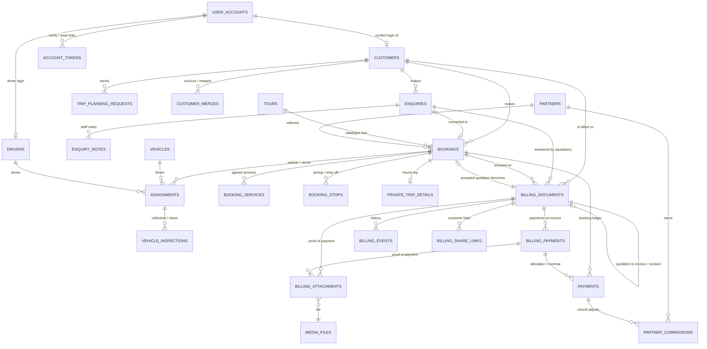

# SL Tours data model

This describes the PostgreSQL database after migration **V25** (5 October 2026): what each table is for, how the records
connect, what was wrong before V25 and what changed. Staff procedures are in
[Staff data guide](../operations/STAFF_DATA_GUIDE.md). Backups are in [Backup and recovery](../operations/BACKUP_AND_RECOVERY.md).

There is one database. Every change goes through a Flyway migration in `apps/api/src/main/resources/db/migration`.

## 1. Audit findings (before V25)

Findings come from reading all 24 migrations, the JPA entities and repositories, the JDBC queries in the services, and
the row counts in the local development database.

| Finding | Effect | Resolution in V25 |
| --- | --- | --- |
| **No customer record in use.** V1 created `customers`, but no code read or wrote it. Each enquiry, booking, invoice and trip-planner request kept its own copy of name, email and phone. The staff "Customers" list was computed by grouping booking emails, so it had no stable id, no history and no way to correct details. | Staff could not see one person's full history; enquiries and invoices were missing from it; nothing could be edited or merged. | `customers` is now the operational customer record. Every enquiry, booking, document and trip-planner request has a `customer_id`, set by the database from the email address on every insert, whichever code path wrote it. |
| **Login and customer data were the same thing.** The only customer identity was `user_accounts`, which also holds the password hash. | Guest customers had no record; registering looked like becoming a customer. | `user_accounts` stays the login (credentials, role, verification). `customers.account_id` links a login to its customer record **only after the address is verified**. |
| **Two payment systems that never met.** Booking payments (`payments`, recorded immediately, driving `bookings.amount_paid_cents` and partner commission) and invoice payments (`billing_payments`, confirmed by an administrator, with a receipt). | A confirmed invoice payment never reached the booking or commission. Recording both counted the money twice. | A confirmed invoice payment for a booking now writes an **allocation** row to the booking ledger in the same transaction, and a reversal writes a matching negative row. Direct booking payments are refused once a booking has an issued invoice. |
| **No path from an accepted quotation to a booking.** Quotations could become invoices, but not bookings. Quotations did not record the enquiry they answered. | Staff retyped quoted trips as bookings. The enquiry, quotation and booking were not linked. | `billing_documents.enquiry_id`, `bookings.source_quotation_id` (unique), a `QUOTED` booking type, and `booking_services` and `booking_stops` copied from the quotation's frozen snapshot. |
| **Confirmed payments could not be reversed.** Only pending payments could be rejected. | A bounced EFT could not be undone without voiding or revising the invoice. | `billing_payments.status = REVERSED`, with who, when and why. The receipt stays on file. |
| **Booking deletion would cascade.** `assignments.booking_id` was `ON DELETE CASCADE`, but inspections reference assignments. | Deleting a booking would either fail late or erase assignment history. | Changed to restrict. No code deletes bookings. |
| **Missing constraints.** Nothing stopped `amount_paid_cents > total_amount_cents`; two enquiries could claim the same booking; login emails were lowercase only by convention. | Silent inconsistencies. | `bookings_paid_within_total`, `ux_enquiries_converted_booking`, `user_accounts_email_lower`. |
| **Dead V1 tables.** `trips`, `trip_days`, `itinerary_items`, `notifications` and `review_requests` had no rows and no code. | Confusion: two meanings of "trip". | Dropped. The migration stops if any of them holds a row. |
| **Legacy demo-only tables.** `quotes` and `quote_items` hold only the V2 sample row; `payments.quote_id` is never set. | A second meaning of "quote". | Kept for now (they hold seed data) and marked legacy here. Remove them with the sample data (§7). |
| **Missing indexes for staff queues.** | Follow-up, open-invoice and pending-payment lists scanned whole tables. | Partial indexes added (§6). |

What was already sound and is kept:

- Billing documents are **frozen when issued**: `snapshot` holds the customer, lines, totals, company and banking details as issued.
- Numbers come from `document_sequences` under a row lock (`NumberAllocator`), are unique per kind, and are never reused, voids included.
- Quotation-to-invoice conversion and every create request are idempotent.
- All money is held as integer cents and computed in Java `long` arithmetic, with no floating point.
- Corrections are made by revision: a new number, with the old document voided and its payments carried over.

## 2. Relationship diagram



`admin_audit_events` records actions by actor and action and is not foreign-keyed. `company_settings` and
`document_sequences` stand alone.

## 3. The customer journey

```
Enquiry ──(Prepare quotation)──▶ Quotation (draft → issued) ──(Accept and create booking)──▶ Booking (QUOTED)
                                         │                                                     │
                                         └──(Convert to invoice)──▶ Invoice (draft → issued) ◀─┘ booking_id
                                                                         │
                                         Payment recorded (PENDING) ──(admin confirms)──▶ CONFIRMED + receipt
                                                                         │                 └─▶ booking ledger allocation
                                                                         └──(admin reverses)──▶ REVERSED ─▶ ledger reversal
```

- **Enquiry → quotation.** *Prepare quotation* on an enquiry opens a quotation pre-filled with the customer, date,
  passengers and route. `billing_documents.enquiry_id` records which enquiry it answers.
- **Quotation → booking** (`QuotationBookingService`, administrators):
  - The quotation row is locked, it is marked accepted, and one booking is created from the **issued snapshot**: the
    customer, service date, passengers, total in exact cents, one `booking_services` row per quoted line and
    `booking_stops` from the quoted legs.
  - If the quotation has no date or passenger count, staff enter them.
  - `ux_bookings_source_quotation` makes retries and double clicks return the same booking (tested with two
    concurrent requests).
  - The answered enquiry becomes CONVERTED, pointing at the booking.
  - A quotation prepared for an existing booking just keeps that booking.
- **Quotation → invoice.** This existing, idempotent conversion now carries the booking created above.
- **Direct bookings** (website tour bookings, private trips, staff conversion of a tour enquiry) work as before.
  Invoices can be prefilled from a booking. **Standalone invoices** without a booking or enquiry are still allowed.
- **Payment.**
  - Staff record a payment on an invoice (PENDING). An administrator confirms it, which allocates a receipt number,
    freezes the receipt and raises the invoice's `paid_cents`.
  - If the invoice belongs to a booking (in rand), a `payments` row with `billing_payment_id` and
    `allocation_of = PAYMENT` updates the booking's amount paid and partner commission, in the same transaction and
    at most once (`ux_payments_billing_allocation`).
  - An amount above the booking's outstanding total is allocated only up to that total, and the invoice history
    says so.

Multiplicities: a customer has many enquiries, bookings and documents. A booking has many invoices (for example a deposit
and a balance), many ledger rows and many stops. A booking currently has **one** active vehicle and driver
assignment; see decision D1 in §9.

## 4. History, statuses and corrections

**Live data and issued history are separate:**

- **Live records** can change: `customers`, `tours`, `private_trip_rates`, `company_settings`, and booking contact
  fields.
- **Historical records** never change once issued:
  - `billing_documents.snapshot` and the stored issued PDF (`issued_pdf_media_id`);
  - `billing_payments.receipt_snapshot` and the receipt PDF;
  - `booking_services` (copied from the quotation snapshot);
  - `private_trip_details.price_breakdown`;
  - `bookings.total_amount_cents`, fixed when the booking is made.
- Changing a customer's address, a tour price or the company bank details therefore never rewrites an issued
  document. A test changes the tour price and the customer's name after issue and checks both the booking and the
  quotation.

**Three separate statuses:**

- **Document status** (`billing_documents.status`): DRAFT, ISSUED, ACCEPTED or DECLINED (quotations only), VOID.
- **Payment status** (`billing_documents.payment_status`), derived from confirmed payments only: NOT_APPLICABLE,
  UNPAID, PARTIALLY_PAID, PAID. Each `billing_payments.status` is PENDING, CONFIRMED, REJECTED or REVERSED.
- **Booking status** (`bookings.status`): ENQUIRY, QUOTE_PENDING, QUOTE_SENT, AWAITING_PAYMENT, CONFIRMED,
  GUIDE_ASSIGNED, READY, IN_PROGRESS, COMPLETED, CANCELLED, REFUNDED. Bookings created from quotations start at
  AWAITING_PAYMENT.

| Situation | How it is handled |
| --- | --- |
| Draft no longer wanted | *Discard draft* (VOID, no number used). |
| Issued document wrong | *Revise*: a new draft; issuing it gives a new number, voids the original and moves confirmed payments across. |
| Issued document not needed | *Void* with a reason. The number stays used. Refused when there are confirmed payments (revise instead). |
| Payment recorded but never arrived | *Reject* while pending, with a reason. |
| Confirmed payment bounced or recorded in error | *Reverse* (administrators) with a reason. The invoice balance and the booking ledger go back; the receipt stays on file marked reversed. |
| Refund of money genuinely received | For an invoiced booking, reverse the invoice payment. Partial refunds and credit notes are not modelled yet (decision D3). For a booking without invoices, record a booking REFUND as before. |
| Booking cancelled | Booking status CANCELLED; assignments are cancelled with a reason; invoices are voided or revised separately. |
| Duplicate customer | Staff merge two records after checking (administrators); see §5. |

**Who did what:**

- `admin_audit_events` covers every audited action (actor, action, entity, detail, time), including customer
  updates and merges, payment allocations, data exports, verification and password resets.
- `billing_events` keeps the per-document history.
- `customer_merges` stores the exact ids moved by each merge.
- Records also carry their own `created_by`, `issued_by`, `decided_by`, `voided_by`, `reversed_by`, `merged_by` and
  `updated_by` columns.

## 5. Customers, logins and guest records

- **Matching.** `sl_customer_for(email, name, phone)` returns the live customer for an email address (case-insensitive),
  following merges, and creates one if there is none.
  - The `trg_*_customer` triggers on `bookings`, `enquiries`, `billing_documents` and `trip_planning_requests` call it
    on insert, and when the email on a record changes and staff had not linked it by hand.
  - Names and phone numbers never join two people. They only produce **possible duplicate** suggestions.
- **Logins.**
  - A login (`user_accounts`) belongs to a customer record only after the account holder opens the emailed
    verification link.
  - What a customer can see in their account is decided by `account_id` on each record, which is set for records made
    while signed in, or for guest records linked after verification.
  - Registering with a matching address that has not been verified shows nothing.
- **Merging** (administrators, with a reason):
  - The merged record's enquiries, bookings, documents and trip-planner requests move to the survivor.
  - The merged record stays, with `merged_into_id` set. The moved ids are stored in `customer_merges.moved`, and the
    merge is audited.
  - Refused when both records have a login.
  - Record ownership (`account_id`) is never changed by a merge.
  - There is no automatic unmerge; `customer_merges.moved` lists exactly what to move back.

## 6. Data dictionary

Money is in **integer cents** (`*_cents`). Rand is the base currency; documents carry their own `currency`. Times are
`timestamptz` (UTC), business dates are `date` (South African time).

### People and access
| Table | Purpose | Key columns |
| --- | --- | --- |
| `customers` | Operational customer record (one per person, by email). | `email` (unique among live records, lowercase), `name`, `phone`, `phone_digits` (normalised, +27 for leading 0), `country`, `notes` (staff only), `account_id` (verified login, unique), `merged_into_id`/`merged_at`/`merged_by`, `demo_data`, `version` |
| `customer_merges` | One row per merge. | `survivor_id`, `merged_id`, `reason`, `moved` (jsonb of moved ids per table), `merged_by`, `merged_at` |
| `user_accounts` | Logins only. | `email` (unique, lowercase), `password_hash` (bcrypt 12), `role` ADMIN/STAFF/CUSTOMER/DRIVER/PARTNER, `enabled`, `email_verified_at`, `phone`, `last_login_at` |
| `account_tokens` | Email verification and password reset links. | `purpose`, `token_hash` (SHA-256; the token itself is never stored), `email` (the address it was sent to), `expires_at`, `used_at` |
| `drivers` | Driver profile and verification. | `account_id` (driver login), `verification_status`, licence and PrDP expiry |
| `partners` (+ `partner_*`) | Referral and supplier partners, agreements, commissions, payouts. | `account_id`, `referral_code`; commissions reference bookings and refunds |

### Sales
| Table | Purpose | Key columns |
| --- | --- | --- |
| `enquiries` | Website, trip-planner, assistant and private-trip quote requests. | `reference` SLE-…, `source`, `enquiry_type`, `status` NEW/IN_PROGRESS/AWAITING_CUSTOMER/CONVERTED/CLOSED, contact copy, `customer_id`, `account_id` (owner), `converted_booking_id` (unique), `idempotency_key` |
| `enquiry_notes` | Staff notes; never shown to customers. | `author`, `body` |
| `trip_planning_requests` | Plan-my-trip submissions (also mirrored as enquiries). | `customer_id` |
| `billing_documents` | Quotations and invoices. | `kind`, `status`, `number` (unique per kind, never reused), `customer_id`, `account_id`, `enquiry_id`, `booking_id`, `source_quotation_id`, `revision_of_id`/`superseded_by_id`, `content` (editable draft), `snapshot` (frozen at issue), totals in cents, `paid_cents`, `payment_status`, `internal_notes` (staff only) |
| `document_sequences` | Next number per series: INVOICE, QUOTATION, RECEIPT. | `next_number`, `confirmed` (issuing is blocked until an administrator confirms it) |

### Bookings and operations
| Table | Purpose | Key columns |
| --- | --- | --- |
| `bookings` | The agreed trip. | `reference` SLT-…, `booking_type` TOUR/PRIVATE_TRIP/QUOTED, `tour_id`, `title` (QUOTED), `source_quotation_id` (unique), `customer_id`, `account_id` (owner), contact copy as given at booking time, `travel_date`, `guests`, `status`, `total_amount_cents`, `amount_paid_cents` (≤ total), referral columns, `demo_data` |
| `booking_services` | Services and prices agreed on a quoted booking. | `line_order`, `title`, `quantity` numeric(9,2), `unit_price_cents`, `line_total_cents`, `tour_id` |
| `booking_stops` | Pickup and drop-off stops per leg. | `leg_order`, `stop_order`, `kind`, `location` |
| `private_trip_details` | Hourly private trips: window, rate source and frozen price breakdown. | 1:1 with booking |
| `assignments` | Vehicle and driver for a booking's time window (no double booking: GiST exclusion constraints). | `status`, `starts_at`/`ends_at`/`blocked_until`; one active per booking |
| `vehicles`, `vehicle_restrictions`, `vehicle_images`, `vehicle_amenities` | Fleet. | `operational_status`, `listing_status` |
| `vehicle_inspections`, `inspection_photos` | Collection and return checks. | linked to assignment, driver, vehicle |
| `guides` | Legacy guide list (seed data only; assignments can name a guide). | |

### Money
| Table | Purpose | Key columns |
| --- | --- | --- |
| `billing_payments` | Payments against invoices. | `status` PENDING/CONFIRMED/REJECTED/REVERSED, `receipt_number` (unique), `receipt_snapshot`, `idempotency_key`, decided/reversed by, when and why |
| `payments` | Booking ledger: payments and refunds per booking (drives `amount_paid_cents` and commission). | `kind` PAYMENT/REFUND, `billing_payment_id` + `allocation_of` PAYMENT/REVERSAL for rows that follow an invoice payment, `idempotency_key`; append-only |
| `billing_attachments` | Proof-of-payment files (staff- or customer-uploaded). | `payment_id` (null = customer upload not yet matched), `media_id`, `uploaded_by` |
| `billing_share_links` | Expiring customer links (hash of the token only). | `expires_at`, `revoked_at`, `open_count` |
| `billing_events` | Per-document history. | append-only |
| `media_files` | Stored files (private by default) with checksum. | `storage_key`, `sha256`, `deleted_at` (soft delete) |

### Catalogue and settings
`tours` (+ `tour_*` lists), `private_trip_rates`, `private_trip_fees`, `vehicle_options`, `activities` (+ `activity_*`),
`planning_*`, `site_images`, `company_settings` (one row: company, banking, terms, tax, defaults), `operations_settings`.
These are live data; documents and bookings keep their own copies of what was agreed.

### Audit
`admin_audit_events`: append-only (the application database role cannot update or delete it).

### Indexes added in V25
`ux_customers_email` (partial), `idx_customers_name`, `idx_customers_phone`, `customer_id` on every linked table,
`idx_billing_documents_enquiry`, `ux_bookings_source_quotation`, `ux_payments_billing_allocation`,
`ux_enquiries_converted_booking`, `idx_enquiries_follow_up`, `idx_billing_documents_open`, `idx_billing_payments_pending`.
The duplicate index `idx_enquiries_email` was dropped.

## 7. Development-only data

| Source | What | How to recognise it |
| --- | --- | --- |
| Migration V2 (all environments) | Sample customers, 2 bookings, a trip-planner request and its enquiry, 3 guides, 2 drivers, 4 vehicles, 1 assignment, 1 legacy quote, 1 payment | `demo_data = true` (set by V12); excluded from inventory, queues and reports |
| `DevDataBootstrap` (dev profile only) | Demo driver logins (`*.driver@sltours.local`) | dev profile; never created in production |
| Manual walkthroughs and e2e runs on the local database (3–5 Oct 2026) | Logins `e2e-*`, `dbg-*`, `customer.demo@sltours.local`, partner logins `walkthrough-*@example.com`; invoices **100100** (walkthrough, with a confirmed payment and receipt 1001) and **100101–100105** (e2e); quotation **1001**; bookings and enquiries for `smoke@`, `walk@`, `walkthrough@`, `reassign@`, `walkthrough-guest@example.com` | `tools/db/dev-records-review.sql` lists them |

Automated tests never touch these databases: every integration test starts a disposable PostgreSQL container
(Testcontainers, database `test`), and a test asserts this.

Cleanup is prepared, not applied (`tools/db/dev-records-cleanup.sql`). It needs a verified backup, rolls back unless
`-v apply=1`, voids rather than deletes, and never renumbers. Stored numbering on 5 October 2026: invoice next
**100106**, quotation next **1002**, receipt next **1002**, all confirmed. These come from `document_sequences`, not
from the highest document.

## 8. Transactions and concurrency

| Operation | Protection |
| --- | --- |
| Issue a document | Document row locked; number from `document_sequences` row lock; retried issue returns the same number; snapshot, PDF and number committed together. Concurrency test: `BillingWorkflowIntegrationTest.numbersAreUniqueUnderConcurrency…`. |
| Quotation → booking | Quotation row locked; unique `source_quotation_id`; enquiry conversion in the same transaction. Concurrency test: `DataModelIntegrationTest`. |
| Quotation → invoice | Quotation row locked; unique partial index on `source_quotation_id`. |
| Record / confirm / reverse payment | Invoice row locked; idempotency keys; booking row locked for the allocation; unique `(billing_payment_id, allocation_of)`. |
| Customer merge | Both customer rows locked (`for update`, in id order) with version checks. |
| Enquiry / booking / document create | Idempotency keys with unique constraints. |

## 9. Open business decisions

| # | Decision needed | Current behaviour |
| --- | --- | --- |
| D1 | Should a booking support several vehicle/driver legs (e.g. multi-day trips)? | One active assignment per booking (`ux_assignments_active_booking`); stops can have several legs. Supporting more needs a leg number on assignments and driver-portal changes. |
| D2 | Should passenger names (not just counts) be stored? This is personal data under POPIA; it needs a purpose and a retention rule. | Count only. |
| D3 | Partial refunds and credit notes for invoiced bookings. | Whole-payment reversal only; booking-level refunds are refused once invoice payments exist. |
| D4 | What to do when an invoice for a booking totals more than the booking. | Allocation stops at the booking total, and the invoice history records the remainder. |
| D5 | Retention periods (e.g. 5 years for financial records under the Tax Administration Act; shorter for unsuccessful enquiries). | Nothing is deleted automatically; see the backup guide for the proposed schedule. |
| D6 | Approve the cleanup of the development records listed in §7, and remove the legacy `quotes`/`quote_items` tables with the V2 sample data. | Prepared, not run. |
| D7 | CSV exports are limited to administrators. Should staff export? | Administrators only, audited. |
